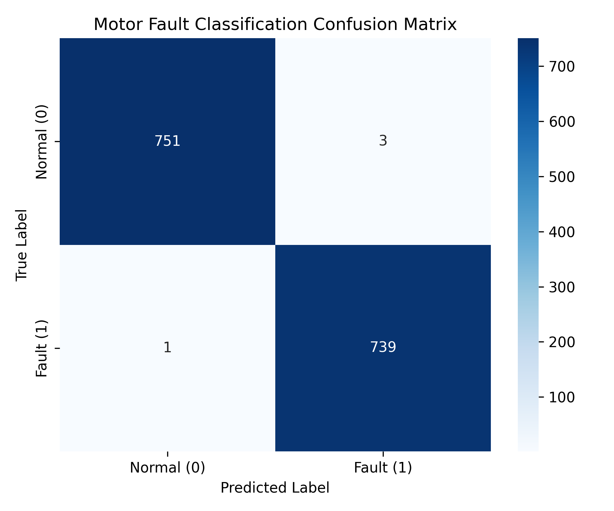
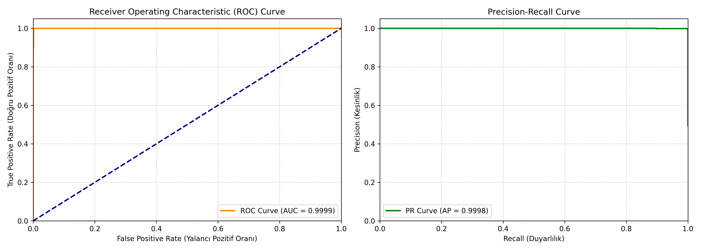

# Sofia AI: Fault Induction Motor Classifier 🚀

This repository contains a deep learning-based fault detection and classification system for induction motors using PyTorch. The model is built on a custom **1D Convolutional Neural Network (1D CNN)** designed to analyze high-frequency time-series sensor data from motors (normal vs. imbalance/faulty conditions).

## 📊 Project Highlights
- **Dataset:** Fault Induction Motor Dataset (Kaggle)
- **Architecture:** 1D CNN (Conv1D layers, MaxPool1D, AdaptiveAvgPool1D, and Linear Classifier)
- **Test Accuracy:** **99.73%** 🔥
- **ROC AUC:** **0.99985** 📈
- **Average Precision (AP):** **0.99984** 🎯
- **Loss Function:** Cross-Entropy Loss
- **Optimizer:** Adam (Learning Rate: 0.001)

---

## 📈 Model Performance & Evaluation
The trained model achieved near-perfect performance during evaluation on unseen test datasets, with only 4 misclassifications out of 1,494 samples.

### Confusion Matrix
Below is the confusion matrix illustrating the classification performance on the test set:



### Advanced Metrics (ROC & Precision-Recall Curves)
To further validate the model robustness, we evaluated the ROC (Receiver Operating Characteristic) and Precision-Recall curves. Both areas are near-perfect:



### Classification Report
```text
              precision    recall  f1-score   support

  Normal (0)       1.00      1.00      1.00       754
    Fault (1)       1.00      1.00      1.00       740

    accuracy                           1.00      1494
   macro avg       1.00      1.00      1.00      1494
weighted avg       1.00      1.00      1.00      1494
```

---

## 🛠️ Tech Stack & Libraries
- **Language:** Python 3
- **Deep Learning Framework:** PyTorch
- **Data Manipulation:** Pandas, NumPy, Scikit-learn
- **Visualization:** Matplotlib, Seaborn

---

## 💾 Repository Structure
```bash
├── sofia_ai_fault_induction_motor.pt  # Saved PyTorch Model Weights
├── confusion_matrix.png               # Model evaluation performance plot
├── advanced_metrics.png               # ROC and Precision-Recall plots
└── README.md                          # Project documentation
```

---

## 🎯 How to Load the Model in PyTorch

To load the pretrained model weights into your PyTorch environment, use the following code structure:

```python
import torch
import torch.nn as nn

# 1. Define the same network architecture
class MotorFaultClassifier(nn.Module):
    def __init__(self, input_channels=8, num_classes=2):
        super(MotorFaultClassifier, self).__init__()
        self.conv1 = nn.Conv1d(in_channels=input_channels, out_channels=32, kernel_size=5, stride=2, padding=2)
        self.relu1 = nn.ReLU()
        self.pool1 = nn.MaxPool1d(kernel_size=2)
        self.conv2 = nn.Conv1d(in_channels=32, out_channels=64, kernel_size=5, stride=2, padding=2)
        self.relu2 = nn.ReLU()
        self.pool2 = nn.MaxPool1d(kernel_size=2)
        self.adaptive_pool = nn.AdaptiveAvgPool1d(10)
        self.fc = nn.Linear(64 * 10, num_classes)

    def forward(self, x):
        x = x.transpose(1, 2)
        x = self.pool1(self.relu1(self.conv1(x)))
        x = self.pool2(self.relu2(self.conv2(x)))
        x = self.adaptive_pool(x)
        x = x.view(x.size(0), -1)
        x = self.fc(x)
        return x

# 2. Instantiate and load weights
model = MotorFaultClassifier(input_channels=8)
model.load_state_dict(torch.load('sofia_ai_fault_induction_motor.pt', map_location=torch.device('cpu')))
model.eval()
print("Model weights loaded successfully!")
```
